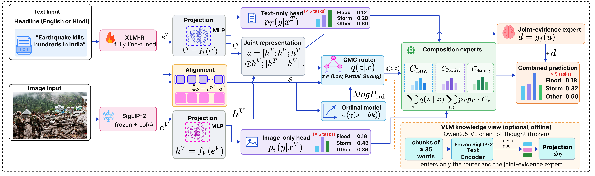

# IndicCrisis

**IndicCrisis: A Benchmark and Explainable Correlation-Aware Framework for Indic-Multilingual Multimodal
Crisis Understanding** (under review, ACM Web Conference 2026)

IndicCrisis is a bilingual **English–Hindi** dataset of **6,862 disaster news articles** (headline + image).
Every article is annotated for five crisis tasks (crisis type, severity, informativeness, humanitarian category,
resource need) **three times**: from the text alone, from the image alone and for the article as a whole,
together with the **cross-modal correlation (CMC)** between text and image (*Low / Partial / Strong*). This
step-wise annotation makes it possible to evaluate *how* a model uses each modality, not only whether its final
label is right.

This repository contains the model of the paper, **CCEC-G**, all baselines, the vision–language-model (VLM)
experiments, the step-wise diagnostics, the CrisisMMD experiments and the scripts that build every table and
figure of the paper and its supplementary material.

<p align="center">
  
</p>

**CCEC-G** (Correlation-Conditioned Evidence Composition with Graph-contrastive correlation learning) follows
the annotation: a text-only and an image-only head judge every task from one modality, a CMC router estimates
how strongly text and image correspond, and composition experts (one table per correlation regime) combine the
two judgements. Every prediction can be traced back to the text judgement, the image judgement, the regime and
the table entry that produced it. A CMC-weighted graph contrastive loss and an ordinal loss teach the model to
measure correlation; an optional frozen VLM "knowledge view" feeds only the router and the joint-evidence expert.

## Contents

- [Dataset Details](#dataset-details)
- [Main results](#main-results)
- [Repository structure](#repository-structure)
- [Installation](#installation)
- [Data](#data)
- [Quick start](#quick-start)
- [Reproducing the paper](#reproducing-the-paper)
- [Step-wise diagnostics for your own model](#step-wise-diagnostics-for-your-own-model)
- [Smoke test](#smoke-test)
- [Troubleshooting](#troubleshooting)
- [Citation](#citation) · [Licence](#licence)


## Dataset Details 
# IndicCrisis: dataset documentation

IndicCrisis is a bilingual (English–Hindi) multimodal dataset of **6,862 disaster news posts**, each pairing a news headline with its image. Every post is annotated for five crisis tasks **three times** (text only, image only, combined) and once for the **cross-modal correlation (CMC)** between text and image: 1 + 5 × 3 = **16 annotation fields per post**.

**Contents:** [1. Overview](#1-overview) · [2. Collection](#2-collection) · [3. Retrieval keywords](#3-retrieval-keywords) · [4. Annotation scheme](#4-annotation-scheme) · [5. Label consolidation](#5-label-consolidation) · [6. Label distributions by language](#6-label-distributions-by-language) · [7. Agreement between the views](#7-agreement-between-the-views) · [8. Files](#8-files)

## 1. Overview

| Language | Posts | Share | Words per text (mean / median) | Characters per text (mean / median) |
| --- | ---: | ---: | ---: | ---: |
| English | 3,119 | 45.5% | 14.2 / 14 | 86.3 / 86 |
| Hindi | 3,743 | 54.5% | 44.6 / 39 | 219.8 / 190 |
| All | 6,862 | 100.0% | 30.8 / 22 | 159.1 / 119 |


The language of a post is the script of its text (Devanagari → Hindi, otherwise English).

## 2. Collection

Disaster news articles were collected by keyword-based retrieval from English and Hindi news websites. The two languages were collected independently, with language-specific keyword lists (Section 3) and different sources, to account for differences in news coverage.

| Language | Sources |
| --- | --- |
| Hindi | Dainik Bhaskar, Amar Ujala, NDTV Hindi, BBC Hindi, Google News RSS (Hindi) |
| English | Google News RSS, ThePrint |


Retrieval was run per year and quarter. Retrieved articles were checked for language, keyword relevance, publication period and a minimum text length; duplicate URLs and articles with corrupted or garbled text were removed. Each post pairs the article's text with its news image.

## 3. Retrieval keywords

Keywords are grouped into thematic categories; every keyword has a Hindi equivalent (and a Hinglish variant). The complete trilingual dictionary is in [`KEYWORDS.md`](KEYWORDS.md).

| Category | Keywords | Examples (English) | Examples (Hindi) |
| --- | ---: | --- | --- |
| Water-Based Disasters | 21 | flood, major flood, flash flood, torrential rain, water rise | बाढ़, बड़ी बाढ़, अचानक बाढ़, मूसलाधार बारिश |
| Severe Storms & Weather Events | 20 | tornado, deadly tornado, tornado victim, twister, tornado damage | बवंडर, घातक बवंडर, बवंडर का शिकार, बवंडर |
| Explosions & Violence / Bombing | 19 | explosion, massive explosion, huge explosion, another explosion, missing explosion | विस्फोट, विशाल विस्फोट, बहुत बड़ा विस्फोट, एक और विस्फोट |
| Human Impact & Casualty Tracking | 36 | death toll, death confirmed, death cost, people dead, people killed | मृत्यु दर, मृत्यु की पुष्टि, मृत्यु की कीमत, लोग मर गए |
| Physical Infrastructure & Environmental Damage | 21 | damage, destroyed, destruction, devastating, rubble | नुकसान, नष्ट, विनाश, तबाही |
| Emergency Response & Relief Operations | 32 | rescue, daring rescue, amazing rescue, relief, relief effort | बचाव, साहसी बचाव, शानदार बचाव, राहत |
| Media & Communication  /  Information Dissemination | 17 | breaking news, live coverage, footage, video, shocking video | ताजा खबर, सीधा कवरेज, फुटेज, वीडियो |
| Community & Emotional / Spiritual Response | 34 | affected, affected area, affected tornado, flood affected, hurricane affected | प्रभावित, प्रभावित क्षेत्र, प्रभावित बवंडर, बाढ़ से प्रभावित |
| Cross-Cutting Keywords | 30 | crisis, crisis deepen, crisis rise, crisis worsen, crisis unfold | संकट, संकट गहराना, संकट बढ़ना, संकट बदतर होना |


Counts are unique English keywords per category; a keyword can belong to several categories.

## 4. Annotation scheme

| Task | Annotated for | Labels |
| --- | --- | --- |
| T0 Cross-modal correlation (CMC) | post (once) | Strong, Partial, Low |
| T1 Crisis type | text, image, combined | Flood / Water Disaster; Cyclone / Storm / Extreme Weather; Earthquake & Geological; Fire & Industrial Accident; Human Casualties; Infrastructure Damage; Other |
| T2 Severity | text, image, combined | Critical, Serious, Moderate |
| T3 Informativeness | text, image, combined | Informative, Low Informativeness |
| T4 Humanitarian category | text, image, combined | Affected Individuals, Infrastructure & Utilities, Rescue & Medical, Not Humanitarian |
| T5 Resource need | text, image, combined | Medical, Rescue Equipment, Shelter & Relief Materials, Other, No Resource Need |


**Text only**: label from the headline alone. **Image only**: label from the image alone. **Combined**: label from text and image together. A decision is *image-dependent* when the combined label differs from the text-only label.

### Label definitions

| Task | Label | Definition |
| --- | --- | --- |
| T0 CMC | Strong | The image directly depicts the event, location or impact described in the text. |
|  | Partial | The image relates to the same disaster type or general context, but not to the specific event or details in the text. |
|  | Low | The image has a weak or no semantic relation to the text (weakly correlated or uncorrelated). |
| T1 Crisis type | Flood / Water Disaster | Floods, flash floods, torrential rain and other water-related disasters. |
|  | Cyclone / Storm / Extreme Weather | Cyclones, hurricanes, tornadoes, storms and other severe weather events. |
|  | Earthquake & Geological | Earthquakes, landslides and other geological events. |
|  | Fire & Industrial Accident | Fires, explosions, and industrial or infrastructure accidents. |
|  | Human Casualties | Content centred on deaths, injuries or missing persons, where no single hazard type dominates. |
|  | Infrastructure Damage | Content centred on structural or physical damage, where no single hazard type dominates. |
|  | Other | Crisis events not covered by the categories above. |
| T2 Severity | Critical | Multiple confirmed casualties; significant infrastructure damage; active threat; state-level emergency; large-scale evacuation. |
|  | Serious | Isolated confirmed casualties; localised damage; disrupted services. |
|  | Moderate | No or few confirmed casualties; limited damage; precautionary alerts or a developing situation; also preparedness or resolved content with no immediate threat. |
| T3 Informativeness | Informative | Provides useful situational awareness, even without full specificity (e.g. “roads in the district are blocked”). |
|  | Low Informativeness | General background, vague or emotional framing, repeated information without new facts, advertorial or filler content, decorative images. |
| T4 Humanitarian | Affected Individuals | Casualty counts, injury reports, missing persons, survivor accounts, displaced population figures. |
|  | Infrastructure & Utilities | Damage to roads, bridges or rail; power-grid failure; hospital or school damage; dam status; pipeline rupture. |
|  | Rescue & Medical | Active search-and-rescue missions (NDRF/SDRF, Coast Guard, air rescue); casualty treatment; hospital capacity; post-disaster health risks. |
|  | Not Humanitarian | Purely political commentary or content with no humanitarian dimension. |
| T5 Resource need | Medical | Medicines, blood, medical equipment, ambulances, ICU capacity. |
|  | Rescue Equipment | Helicopters, boats, excavators, breathing apparatus. |
|  | Shelter & Relief Materials | Tents, blankets and relief for displaced people. |
|  | Other | Food and water; logistics and access (transport, road clearance, communication); financial needs (emergency funds, compensation, insurance, crop losses). |
|  | No Resource Need | The content neither reports nor implies any resource need. |


## 5. Label consolidation

The initial rulebook used finer classes; sparse classes were merged after annotation. In addition, the English and Hindi annotation files used different names for two crisis types, which were harmonised.

| Task | Initial label(s) | Final label | Reason |
| --- | --- | --- | --- |
| T0 CMC | Strong | Strong | unchanged |
| T0 CMC | Partial | Partial | unchanged |
| T0 CMC | Weak; Uncorrelated | Low | sparse classes merged |
| T1 Crisis type | Flood (EN and HI files) | Flood / Water Disaster | renamed |
| T1 Crisis type | Cyclone (EN and HI files) | Cyclone / Storm / Extreme Weather | renamed |
| T1 Crisis type | Earthquake (EN file); Earthquake & Geological (HI file) | Earthquake & Geological | same class, different names in the two files |
| T1 Crisis type | Wildfire (EN file); Fire (HI file) | Fire & Industrial Accident | same class, different names in the two files |
| T2 Severity | Moderate; Minor/Informational | Moderate | sparse class merged |
| T3 Informativeness | Low Informativeness; Not Informative | Low Informativeness | sparse class merged |
| T4 Humanitarian | Rescue & Search Operations; Medical & Health | Rescue & Medical | sparse classes merged |
| T5 Resource need | Food & Water; Logistics & Access; Financial | Other | sparse classes merged |


## 6. Label distributions by language

Number of posts (and share within the language) per class, for each annotation view. EN: English (3,119 posts), HI: Hindi (3,743), All: 6,862.

### Cross-modal correlation (T0)

| Class | EN | HI | All |
| --- | ---: | ---: | ---: |
| Strong | 2,068 (66.3%) | 2,905 (77.6%) | 4,973 (72.5%) |
| Partial | 755 (24.2%) | 444 (11.9%) | 1,199 (17.5%) |
| Low | 296 (9.5%) | 394 (10.5%) | 690 (10.1%) |

### Crisis type (T1)

| Class | EN text | EN image | EN combined | HI text | HI image | HI combined | All text | All image | All combined |
| --- | ---: | ---: | ---: | ---: | ---: | ---: | ---: | ---: | ---: |
| Flood / Water Disaster | 714 (22.9%) | 714 (22.9%) | 700 (22.4%) | 970 (25.9%) | 920 (24.6%) | 975 (26.0%) | 1,684 (24.5%) | 1,634 (23.8%) | 1,675 (24.4%) |
| Cyclone / Storm / Extreme Weather | 341 (10.9%) | 288 (9.2%) | 335 (10.7%) | 774 (20.7%) | 735 (19.6%) | 763 (20.4%) | 1,115 (16.2%) | 1,023 (14.9%) | 1,098 (16.0%) |
| Earthquake & Geological | 307 (9.8%) | 278 (8.9%) | 320 (10.3%) | 727 (19.4%) | 674 (18.0%) | 727 (19.4%) | 1,034 (15.1%) | 952 (13.9%) | 1,047 (15.3%) |
| Fire & Industrial Accident | 540 (17.3%) | 468 (15.0%) | 544 (17.4%) | 454 (12.1%) | 381 (10.2%) | 457 (12.2%) | 994 (14.5%) | 849 (12.4%) | 1,001 (14.6%) |
| Human Casualties | 601 (19.3%) | 478 (15.3%) | 560 (18.0%) | 217 (5.8%) | 163 (4.4%) | 209 (5.6%) | 818 (11.9%) | 641 (9.3%) | 769 (11.2%) |
| Infrastructure Damage | 150 (4.8%) | 213 (6.8%) | 173 (5.5%) | 292 (7.8%) | 323 (8.6%) | 292 (7.8%) | 442 (6.4%) | 536 (7.8%) | 465 (6.8%) |
| Other | 466 (14.9%) | 680 (21.8%) | 487 (15.6%) | 309 (8.3%) | 547 (14.6%) | 320 (8.5%) | 775 (11.3%) | 1,227 (17.9%) | 807 (11.8%) |


### Severity (T2)

| Class | EN text | EN image | EN combined | HI text | HI image | HI combined | All text | All image | All combined |
| --- | ---: | ---: | ---: | ---: | ---: | ---: | ---: | ---: | ---: |
| Critical | 1,512 (48.5%) | 1,295 (41.5%) | 1,453 (46.6%) | 877 (23.4%) | 722 (19.3%) | 841 (22.5%) | 2,389 (34.8%) | 2,017 (29.4%) | 2,294 (33.4%) |
| Serious | 1,003 (32.2%) | 1,052 (33.7%) | 1,054 (33.8%) | 986 (26.3%) | 935 (25.0%) | 1,009 (27.0%) | 1,989 (29.0%) | 1,987 (29.0%) | 2,063 (30.1%) |
| Moderate | 604 (19.4%) | 772 (24.8%) | 612 (19.6%) | 1,880 (50.2%) | 2,086 (55.7%) | 1,893 (50.6%) | 2,484 (36.2%) | 2,858 (41.6%) | 2,505 (36.5%) |


### Informativeness (T3)

| Class | EN text | EN image | EN combined | HI text | HI image | HI combined | All text | All image | All combined |
| --- | ---: | ---: | ---: | ---: | ---: | ---: | ---: | ---: | ---: |
| Informative | 2,811 (90.1%) | 2,099 (67.3%) | 2,697 (86.5%) | 3,221 (86.1%) | 2,872 (76.7%) | 3,021 (80.7%) | 6,032 (87.9%) | 4,971 (72.4%) | 5,718 (83.3%) |
| Low Informativeness | 308 (9.9%) | 1,020 (32.7%) | 422 (13.5%) | 522 (13.9%) | 871 (23.3%) | 722 (19.3%) | 830 (12.1%) | 1,891 (27.6%) | 1,144 (16.7%) |


### Humanitarian category (T4)

| Class | EN text | EN image | EN combined | HI text | HI image | HI combined | All text | All image | All combined |
| --- | ---: | ---: | ---: | ---: | ---: | ---: | ---: | ---: | ---: |
| Affected Individuals | 1,326 (42.5%) | 530 (17.0%) | 999 (32.0%) | 1,133 (30.3%) | 759 (20.3%) | 1,113 (29.7%) | 2,459 (35.8%) | 1,289 (18.8%) | 2,112 (30.8%) |
| Infrastructure & Utilities | 672 (21.5%) | 1,041 (33.4%) | 837 (26.8%) | 1,107 (29.6%) | 1,209 (32.3%) | 1,144 (30.6%) | 1,779 (25.9%) | 2,250 (32.8%) | 1,981 (28.9%) |
| Rescue & Medical | 293 (9.4%) | 436 (14.0%) | 429 (13.8%) | 272 (7.3%) | 251 (6.7%) | 285 (7.6%) | 565 (8.2%) | 687 (10.0%) | 714 (10.4%) |
| Not Humanitarian | 828 (26.5%) | 1,112 (35.7%) | 854 (27.4%) | 1,231 (32.9%) | 1,524 (40.7%) | 1,201 (32.1%) | 2,059 (30.0%) | 2,636 (38.4%) | 2,055 (29.9%) |


### Resource need (T5)

| Class | EN text | EN image | EN combined | HI text | HI image | HI combined | All text | All image | All combined |
| --- | ---: | ---: | ---: | ---: | ---: | ---: | ---: | ---: | ---: |
| Medical | 599 (19.2%) | 194 (6.2%) | 457 (14.7%) | 65 (1.7%) | 45 (1.2%) | 59 (1.6%) | 664 (9.7%) | 239 (3.5%) | 516 (7.5%) |
| Rescue Equipment | 473 (15.2%) | 553 (17.7%) | 546 (17.5%) | 298 (8.0%) | 295 (7.9%) | 312 (8.3%) | 771 (11.2%) | 848 (12.4%) | 858 (12.5%) |
| Shelter & Relief Materials | 550 (17.6%) | 530 (17.0%) | 559 (17.9%) | 198 (5.3%) | 169 (4.5%) | 209 (5.6%) | 748 (10.9%) | 699 (10.2%) | 768 (11.2%) |
| Other | 256 (8.2%) | 446 (14.3%) | 399 (12.8%) | 423 (11.3%) | 354 (9.5%) | 456 (12.2%) | 679 (9.9%) | 800 (11.7%) | 855 (12.5%) |
| No Resource Need | 1,241 (39.8%) | 1,396 (44.8%) | 1,158 (37.1%) | 2,759 (73.7%) | 2,880 (76.9%) | 2,707 (72.3%) | 4,000 (58.3%) | 4,276 (62.3%) | 3,865 (56.3%) |


## 7. Agreement between the views

*Image-dependent*: share of posts whose combined label differs from the text-only label (the image changed the human judgement). *Text = image*: share of posts whose text-only and image-only labels agree.

| Task | Image-dependent EN | Image-dependent HI | Image-dependent All | Text = image EN | Text = image HI | Text = image All |
| --- | ---: | ---: | ---: | ---: | ---: | ---: |
| Crisis type (T1) | 7.0% | 1.9% | 4.2% | 80.3% | 89.8% | 85.5% |
| Severity (T2) | 11.4% | 3.0% | 6.8% | 78.1% | 88.3% | 83.7% |
| Informativeness (T3) | 8.3% | 6.0% | 7.1% | 70.9% | 86.7% | 79.5% |
| Humanitarian category (T4) | 19.4% | 4.2% | 11.1% | 60.0% | 81.1% | 71.5% |
| Resource need (T5) | 17.9% | 3.2% | 9.9% | 66.6% | 89.1% | 78.9% |


## 8. Files

| File | Content |
| --- | --- |
| `KEYWORDS.md` | complete English–Hindi–Hinglish retrieval keyword dictionary |
| `stats/overview_by_language.csv` | posts and text length per language |
| `stats/distribution_<task>.csv` | label counts and shares per class, view and language |
| `stats/view_agreement.csv` | image-dependent decisions and text–image agreement per task and language |
| `latex/dataset_tables.tex` | the same tables in LaTeX |


## Main results

**IndicCrisis test set** (macro-F1 %, mean ± std over seeds 42, 43, 44; Avg.₅ = mean over the five tasks of the
combined label):

| Model | Avg.₅ | CMC |
|---|---|---|
| ConvNeXt-B (image only) | 46.37 ± 1.58 | – |
| XLM-R (text only) | 63.04 ± 1.41 | – |
| MANN / CAMM (re-implemented) | 36.52 / 46.23 | – |
| ALIGN / CLIP (re-implemented) | 49.13 / 56.26 | – |
| DMCC / RoBERTaMFT (re-implemented) | 59.98 / 62.92 | – |
| Fusion (ours, XLM-R) | 64.38 ± 1.44 | 52.83 |
| **CCEC-G (ours, XLM-R)** | **63.86 ± 1.22** | **53.99** |

CCEC-G is ahead of all six re-implemented crisis classifiers in every seed and matches the Fusion classifier
while exposing its intermediate judgements.

**Vision–language models** (test split of seed 42, Avg.₅ macro-F1 %; CMC for the fine-tuned models):

| Model | Params | Zero-shot | CoT | Few-shot (k = 4) | LoRA | CMC (LoRA) |
|---|---|---|---|---|---|---|
| Qwen2.5-VL-7B | 8.3B | 39.79 | 42.53 | 48.46 | 61.87 | 47.58 |
| InternVL3-8B | 8.0B | 42.14 | 44.03 | 50.16 | 61.31 | 44.58 |
| Gemma 3 12B | 12.3B | 42.54 | 43.41 | 50.29 | 62.48 | 45.64 |
| **CCEC-G (ours)** | **0.38B** | – | – | – | **62.55** | **54.17** |

LoRA-tuned VLMs 21–33 times larger reach the same Avg.₅ as CCEC-G (differences not significant) but a
significantly lower CMC (paired bootstrap, p ≤ 0.019). CCEC-G trains in about 18 minutes on one A100.

**Step-wise diagnostics.** Decisions in which the image changed the annotators' judgement are solved about half
as often as the others (≈35% vs. ≈73% accuracy for the strongest models, LoRA-tuned VLMs included), and no model
changes its judgement like the annotators. CrisisMMD results are in the paper.

## Repository structure

```
IndicCrisis/
├── indiccrisis/                    Python package
│   ├── train_ccec.py               CCEC-G, CCEC and Fusion: training, evaluation, alignment analysis
│   ├── ccec_report.py              full evaluation report of a run (confusion matrices, per-class metrics)
│   ├── baselines/
│   │   ├── train_baselines.py      fine-tuned text-only (mBERT, IndicBERT, MuRIL, XLM-R) and image-only models
│   │   └── train_sota.py           MANN, CAMM, RoBERTaMFT, DMCC, CLIP, ALIGN (re-implemented)
│   ├── vlm/
│   │   ├── pilot_reasoning_graph.py   zero-shot VLM prompting (direct, chain-of-thought), parsing, metrics
│   │   ├── vlm_adapt.py            few-shot (retrieved demonstrations) and LoRA fine-tuning of VLMs
│   │   └── embed_vlm_views.py      VLM chain-of-thought -> frozen "knowledge view" for CCEC-G
│   ├── crisismmd/
│   │   ├── prepare_crisismmd.py    CrisisMMD benchmark splits -> IndicCrisis CSV format (with checks)
│   │   └── crisismmd_table.py      mean accuracy / weighted F1 of the CrisisMMD runs
│   ├── analysis/
│   │   ├── modality_reliance.py    step-wise diagnostics (image-dependent decisions, change rate, ...)
│   │   ├── vlm_significance.py     paired bootstrap tests for the VLM comparison
│   │   ├── aggregate_runs.py       mean ± std over seeds, paired t-tests, ablation / alignment tables
│   │   ├── paper_tables.py         main results, language and per-language detail tables
│   │   ├── supplementary_tables.py tables of the supplementary material
│   │   ├── make_figures.py         all figures (vector PDF, ACM column widths)
│   │   ├── qualitative.py          qualitative analysis (image, text, annotated and predicted step-wise labels)
│   │   ├── export_prompts.py       the exact VLM prompts as text files
│   │   └── ...                     language metrics, near-duplicate check, examples
│   └── tools/                      data checks, checkpoint conversion to safetensors
├── scripts/                        resumable multi-GPU run scripts (one per experiment family)
├── tests/                          synthetic data + smoke test (every pipeline with tiny mock models)
├── data/README.md                  expected data format
├── docs/reproduce.md               which command produces which table / figure of the paper
├── docs/qualitative/               English glosses and notes of the qualitative examples
├── assets/                         architecture figure
└── legacy/                         superseded table scripts, kept for reference
```

## Installation

Python ≥ 3.9 and a CUDA GPU. All paper runs used one NVIDIA A100 (40 GB) per run.

```bash
git clone <anonymous repository URL> IndicCrisis && cd IndicCrisis
# install PyTorch for your CUDA version first: https://pytorch.org
pip install -r requirements.txt
pip install -e .                    # optional: makes `python -m indiccrisis...` work from anywhere
```

| Environment | Used for | Install |
|---|---|---|
| main | CCEC-G, baselines, re-implemented models, CrisisMMD, analysis | `pip install -r requirements.txt` |
| VLM (separate env recommended) | zero-shot / few-shot / LoRA VLMs, VLM knowledge view | `pip install -e ".[vlm]"` + a recent `transformers` (Qwen2.5-VL, InternVL3, Gemma 3); `vllm` optional |

The scripts in `scripts/` put the repository on `PYTHONPATH` themselves, so they work without
`pip install -e .` and from any working directory (typically the folder that holds the data).

## Data

See [`data/README.md`](data/README.md) for the exact format. Expected layout:

```
<data folder>/
├── IndicCrisis_clean.csv           one row per article
└── Merged Images/                  the images (file names as in the CSV)
```

The CSV contains the article text, the image file name and, for each task `T` in {Crisis, Severity,
Informativeness, Humanitarian, Resource}, the columns `T_Text`, `T_Image` and `T_Combined`, plus `CMC`. Check a
copy of the data with `python -m indiccrisis.tools.check_data --csv IndicCrisis_clean.csv --image_dir "Merged Images"`.
CrisisMMD is converted to the same format with `python -m indiccrisis.crisismmd.prepare_crisismmd`.

## Quick start

```bash
CSV=IndicCrisis_clean.csv; IMG="Merged Images"

# CCEC-G (XLM-R text encoder, CMC-weighted graph contrastive learning, ordinal CMC loss)
python -m indiccrisis.train_ccec --csv $CSV --image_dir "$IMG" --text_encoder xlmr \
    --corr graph --nbr_sampler random --ordinal_cmc --seed 42 --save_dir runs/ccecg_s42

# the same with the VLM knowledge view (build vlm_views.npz first, see docs/reproduce.md)
python -m indiccrisis.train_ccec --csv $CSV --image_dir "$IMG" --text_encoder xlmr \
    --corr graph --nbr_sampler random --ordinal_cmc --vlm_view vlm_views.npz --seed 42 --save_dir runs/ccecg_vlm_s42

# Fusion baseline (same encoders and objective, a classifier instead of composition)
python -m indiccrisis.train_ccec --csv $CSV --image_dir "$IMG" --text_encoder xlmr \
    --fusion_baseline --seed 42 --save_dir runs/fusion_s42

# a text-only baseline and a re-implemented crisis classifier
python -m indiccrisis.baselines.train_baselines --model xlmr --csv $CSV --image_dir "$IMG" --save_dir runs/txt_xlmr_s42
python -m indiccrisis.baselines.train_sota --model dmcc --csv $CSV --image_dir "$IMG" --save_dir runs/sota_dmcc_s42
```

Each run writes to its `--save_dir`:

| File | Content |
|---|---|
| `results.json` | arguments, test metrics, training history, efficiency (parameters, time, memory) |
| `report/predictions.csv` | per test post: gold label, prediction and confidence of the text-only, image-only and combined step of every task, and of the CMC |
| `report/` (other files) | per-class metrics, confusion matrices, results per CMC level, `metrics_summary.csv` |

The split is a random 80/10/10 split per seed, stratified by crisis type and language, in which identical
headlines never cross splits. `--split_col` uses fixed splits from a CSV column instead. All paper runs use 10
epochs and seeds 42, 43 and 44.

## Reproducing the paper

[`docs/reproduce.md`](docs/reproduce.md) lists the command that trains each group of models and the command
that builds each table and figure. In short:

| Step | Command |
|---|---|
| Text-only and image-only baselines | `bash scripts/run_baselines.sh $CSV "$IMG"` |
| Re-implemented crisis classifiers | `bash scripts/run_sota.sh $CSV "$IMG"` |
| CCEC-G, CCEC, Fusion and ablations | `bash scripts/run_ablations.sh $CSV "$IMG"` |
| VLMs: zero-shot, few-shot, LoRA | `bash scripts/run_pilot.sh`, `run_vlm_all.sh`, `run_vlm_models.sh` |
| VLM knowledge view | `STEP=1 bash scripts/run_vlm_view.sh $CSV "$IMG"`, then `STEP=2 ...` |
| CrisisMMD | `bash scripts/run_crisismmd.sh` |
| All paper tables | `bash scripts/make_paper_tables.sh` |
| VLM significance tests | `python -m indiccrisis.analysis.vlm_significance ...` |
| Figures | `python -m indiccrisis.analysis.make_figures ...` |
| Supplementary tables, prompts, qualitative examples | `python -m indiccrisis.analysis.{supplementary_tables,export_prompts,qualitative} ...` |

Every run script is **resumable** (finished runs are skipped, so a script can simply be restarted) and
**multi-GPU** (`GPUS="0 1 2"` runs one job per listed GPU); logs go to `<out>/logs/`.

## Step-wise diagnostics for your own model

Any model that outputs text-only, image-only and combined predictions can be evaluated with the step-wise
protocol of the paper. Write a `predictions.csv` in the format of `train_ccec.py` (one row per test post with
`image_name`, `language`, and for every task `T` and view `V` in {Text, Image, Combined} the columns
`T_V_true` and `T_V_pred`, plus `CMC_true` and `CMC_pred`), save it as
`<folder>/<name>_s<seed>/report/predictions.csv`, and run

```bash
python -m indiccrisis.analysis.modality_reliance --runs <folder> --variants <name> --out diag_<name>
```

It reports, per model, the macro-F1 of every step, the combined accuracy on **image-dependent** decisions (the
annotators' combined label differs from their text-only label) and on **text-sufficient** decisions, the
**change rate** (how often the combined prediction differs from the model's own text-only prediction; annotators:
7.4%) and the **change precision** (how often such a change is needed and correct). VLM outputs of
`pilot_reasoning_graph.py` / `vlm_adapt.py` are read with `--vlm <folder>`.

## Smoke test

```bash
bash tests/smoke_test.sh        # CPU, a few minutes: synthetic data + tiny random encoders, no downloads
```

It runs CCEC-G, Fusion, a text baseline, the six re-implemented classifiers, the CrisisMMD conversion and the
CrisisMMD run script end to end. It checks that the pipelines run, not the numbers.

## Troubleshooting

**PyTorch < 2.6 refuses `.bin` checkpoints.** Recent `transformers` no longer load `.bin` weights with older
PyTorch. Convert the affected models (MuRIL, IndicBERT, CLIP, ALIGN, ...) once to safetensors:

```bash
export INDICCRISIS_MODEL_DIR=/path/to/converted_models    # default: the current directory
python -m indiccrisis.tools.convert_to_safetensors        # writes <short>-safetensors/ there
python -m indiccrisis.tools.convert_indicbert
```

Every training script looks for `<short>-safetensors/` in `$INDICCRISIS_MODEL_DIR` before downloading.

**Out of GPU memory.** CCEC-G with XLM-R needs about 7 GB (batch size 16), with the SigLIP-2 text encoder about
3 GB. LoRA fine-tuning of the VLMs fits on one 40 GB GPU with the settings of the scripts.

**An interrupted run.** Start the same script again; finished runs are skipped. A run counts as finished when
its `report/metrics_summary.csv` (CrisisMMD: `results.json`) exists; incomplete run folders are run again.

